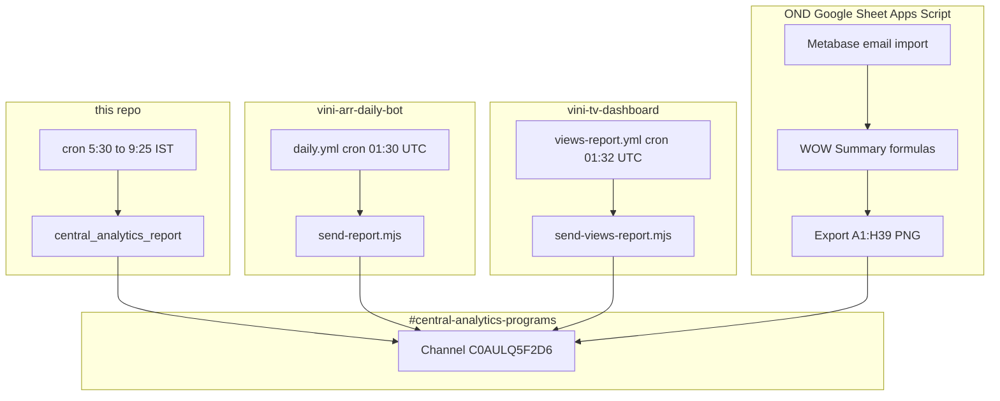

# Central Report — full handoff

Last updated: 2026-10-16.

This file is the map of every pipeline that can post visual analytics to `#central-analytics-programs`. The 6:00 AM Daily report picture in this git project is one sender. It is not the whole of Central Report.

## What “Central Report” means

Central Report is everything that posts visual analytics to the Slack channel `#central-analytics-programs` (channel id `C0AULQ5F2D6` where configured in GitHub secrets or Apps Script properties).

It is not one script or one repo. It is three independent pipelines that may all target the same channel, plus the Daily report picture this repository sends:

| Pipeline | Technology | Typical time (IST) | What gets posted |
| --- | --- | --- | --- |
| Daily report picture | This repo, cron, `central_analytics_report` | 6:00 AM | PNG of the Daily report tab, columns B–H, rows 4–22 |
| Daily Sankey (ARR dashboard) | GitHub Actions — `vini-arr-daily-bot` | 7:00 AM | PNG of VINI Overall Dashboard Sankey (+ projections) |
| VINI Views (slide 2) | GitHub Actions — `vini-tv-dashboard` | 7:02 AM | PNG of CSM “VINI Views” tile board |
| OND Live WoW summary | Google Apps Script on the OND workbook | ~4:22 AM (import + ~7 min wait) plus 6:00 AM backup | PNG of WOW Summary range `A1:H39` |

Each pipeline has its own owner repo or spreadsheet, secrets, and on/off switch. Turning off one does not turn off the others.

## What Central Report is not

Three other VINI automations run around the same morning window and do not post this Daily report picture.

| Workstream | What it does | Slack? |
| --- | --- | --- |
| VINI Accounts Alert | Metabase email → Daily tab → Alerts tab → Log tab on the Alert Tracker sheet | No in the production Apps Script. Any CS Slack table is owned by another automation. Record: `docs/VINI-ACCOUNTS-ALERT.md`. |
| Live accounts RAG | `refreshViniReport` on the live accounts Google Sheet (ROI, refresh log, Metabase-driven refresh) | No central Sankey post. The same 7:00 AM IST trigger time as the Sankey bot is coincidental. |
| VINI TV Dashboard (CEO office) | Password-locked browser TV rotation at `vini-tv-dashboard.pages.dev` | No daily central post unless the Views report workflow runs successfully. |

If `#central-analytics-programs` has no message at 6–7 AM, check which pipeline you expected (Daily report picture vs Sankey vs Views vs OND WoW vs Accounts Alert). The Accounts Alert script will never explain a missing Sankey image. This repo’s cron will never explain a missing Views tile.

## 1. Daily report picture (this repo)

Purpose, sheet id, range, message, recipients, and cron line: `docs/CENTRAL-REPORT.md`.

`CENTRAL_REPORT_PAUSED` in `central_analytics_report/job.py` is the on/off switch for this picture only. It does not stop Sankey, Views, or the OND Apps Script.

## 2. Daily Sankey bot (`vini-arr-daily-bot`)

### Purpose

Every scheduled run captures the live Spyne Console embedded dashboard (VINI product line, projections on, embedded mode) and uploads the screenshot to `#central-analytics-programs`. After each run, the notify user gets a DM (pass or fail). No laptop required.

### Where it lives

| Item | Location |
| --- | --- |
| Repo | `shivaniwhachal/vini-arr-daily-bot` (private, branch `master`) |
| Workflow | `.github/workflows/daily.yml` |
| Entry script | `send-report.mjs` |
| Human readme | `vini-daily-report/README.md` |

### Schedule

| Cron (UTC) | IST | Notes |
| --- | --- | --- |
| `30 1 * * *` | 7:00 AM | Standard `daily.yml` schedule |

GitHub cron is UTC. IST = UTC+5:30.

### Dashboard URL

https://org-settings.spyne.ai/admin/network-dashboard?isDashboard=true&productLine=vini&isReseller=false&showProjections=true&standalone=0

Capture contract:

- Viewport 1440×900 before navigation.
- Wait until `document.body.dataset.dashboardReady === 'true'`.
- If readiness is `'error'`, do not post (treat as failure).
- No auth token in the URL (confirmed Sep 2025: the embedded page loads without a token).
- `standalone=0` removes the standalone preview header.

A URL without the VINI, D2D, and projection filters showed different totals (~$19M vs ~$6.3M). The filtered URL above matches Console VINI + projections.

### Typography fix (Sep 2025)

Sankey dollar labels were too bold in screenshots. Fix in `capture()`: inject `LIGHTER_NUMBERS_CSS` via `page.addStyleTag` after `dashboardReady`, one animation frame, then screenshot. Commit [75d4091](https://github.com/shivaniwhachal/vini-arr-daily-bot/commit/75d4091b6663a323e57846417af95940e6f01539). That commit does not change the URL, the viewport, or the Slack logic.

Reference screenshot: `slack-sankey-lighter.png`.

### GitHub secrets (names only)

| Secret | Role |
| --- | --- |
| `DASHBOARD_HOST` | Host for the dashboard, if the script references it |
| `SLACK_BOT_TOKEN` | Bot token for upload and DM |
| `SLACK_CHANNEL_ID` | Target channel (`C0AULQ5F2D6` for central) |
| `SLACK_NOTIFY_USER_ID` | User to DM on pass or fail |

`SPYNE_AUTH_TOKEN` is not required for capture.

Slack bot identity in the workspace: Daily VINI Report (`@daily_vini_report`).

### Manual run

The workflow supports `workflow_dispatch` with mode `slack-test` (Slack check only) or `report` (full dashboard report).

### Disable or pause Sankey only

As of 2026-10-08, OND plan work may replace the daily central Sankey. The scheduled post may still be active until someone disables it on GitHub.

| Option | Effect |
| --- | --- |
| A (recommended) | Comment out `schedule` in `daily.yml`. Keep `workflow_dispatch` for manual tests. |
| B | Disable the workflow in the GitHub UI. That also stops manual runs. |

Disabling Sankey does not stop the live accounts RAG sheet refresh, an accounts-alert workflow, the OND Apps Script, the VINI Views workflow, or this repo’s 6:00 AM Daily report picture.

## 3. VINI Views second post (`vini-tv-dashboard`)

### Purpose

A second message to `#central-analytics-programs`, shortly after the Sankey post, with a screenshot of slide 2 (CSM feed tile board). Caption pattern: `VINI Views (D2D) | <date>` (wording may predate the CSM-only slide 2).

Built and rendered inside GitHub Actions (build + Vite preview + Playwright), not from the password-locked TV browser in the office.

### Where it lives

| Item | Location |
| --- | --- |
| Repo | `shivaniwhachal/vini-tv-dashboard` |
| Workflow | `.github/workflows/views-report.yml` |
| Script | `scripts/send-views-report.mjs` |
| Deep build notes | `internal/vini-views-daily-report-build-check.md` |

### Schedule

| Cron (UTC) | IST | Intent |
| --- | --- | --- |
| `32 1 * * *` | 7:02 AM | About 2 minutes after Sankey (`01:30` UTC) |

### Behavior

- `npm run build`, then Vite preview, then Playwright opens `?slide=2&static=1` at 1920×1080.
- Wait for `dashboardReady === 'true'` (same contract as the TV app).
- Read check values from the page dataset and verify them against the CSM API (`/api/vini-view` proxy).
- A mismatch or error means no channel post. DM the failure when the token allows.
- `mode=test`: DM only. `mode=post`: channel post plus DM.
- The PNG is kept as a 30-day GitHub artifact.

### Secrets

Same pattern as the Sankey bot: `SLACK_BOT_TOKEN`, `SLACK_CHANNEL_ID` (`C0AULQ5F2D6`), `SLACK_NOTIFY_USER_ID`.

At the time the Views report was built, `SLACK_BOT_TOKEN` was missing on `vini-tv-dashboard`. Scheduled runs fail fast until the token is set in that repo’s Actions secrets. Confirm the current secret in GitHub before relying on the 7:02 AM post.

### Relationship to the TV dashboard

Slide 2 on the CEO TV and slide 2 in the Views report share the same app codebase. The TV deploy is separate from the daily Slack workflow. A TV outage fix does not change whether the Views report posts unless the workflow runs and the secrets are valid.

## 4. OND Live WoW PNG (Apps Script)

### Purpose

For the OND Live Target workbook: import the latest Metabase live email into `Raw_live_METABASE`, let the WOW Summary sheet formulas recalculate, then post a PNG of the WoW table (including MTD in column H) to `#central-analytics-programs` when live alerting is enabled.

This Apps Script is not `central_analytics_report`. Do not replace the 6:00 AM Daily report picture with it, and do not install `scripts/independent-slack-reports.gs` as the sender.

### Flow

1. Metabase email → `processLatestOndEmail` / `runOndDailyPipeline`.
2. Refresh `Raw_live_METABASE` from the CSV.
3. WOW Summary recalculates (Apps Script flush + wait, not a manual browser reload).
4. Wait about 7 minutes (override with script property `OND_WOW_AFTER_IMPORT_WAIT_MINUTES`, for example 5–10).
5. Export PNG `WOW Summary!A1:H39` (through MTD, including Grand Total).
6. Post `image.png`.
   - If `ALERT_LIVE=true` and `SLACK_CHANNEL_ID` is set → `#central-analytics-programs`.
   - Else → the Daily VINI DM, not the central channel.

The script does not compute WoW or MTD in code. The PNG is the display values on the sheet after the import and the wait. It does not pull MTD from Metabase or from Slack.

If MTD looks wrong: fix `Raw_live_METABASE` or the sheet formulas, or increase the wait. Run `diagnoseOndWowMtdLiveCheck` and compare the log fingerprint (`H26`, `H30`, `H34`, `H35`, `H39`) to the browser.

### Triggers (`setupDailyTrigger`)

| Time (IST) | Function | Role |
| --- | --- | --- |
| ~4:15 AM | `processLatestOndEmail` | Import, then schedule the WoW Slack post about 7 minutes later |
| ~6:00 AM | `postOndWowReportToSlack` | Backup image post if that separate morning run is still used |

The 6:00 AM backup can land in the same channel as this repo’s Daily report picture. They are still different images: WoW `A1:H39` versus Daily report `B4:H22`.

### One-time setup for the central channel

- Run `setOndAlertLiveTrue()`.
- Set `SLACK_CHANNEL_ID` via `installOndScriptProperties()` or the Script properties UI.

Code reference: `OND-Code.gs`.

### Manual test

- `runOndDailyPipeline()` — watch Executions: import, then “Scheduled WoW Slack PNG in ~7 min”, then `postOndWowReportToSlackAfterImport_`.
- `postOndWowReportToSlack()` alone — PNG and Slack test without the import wait.

## Master schedule

All times IST unless noted. A run may slip a few minutes.

| Local time (IST) | UTC cron (if GitHub) | System | Post to central? |
| --- | --- | --- | --- |
| ~4:15 | — | OND import start | No yet |
| ~4:22 | — | OND WoW PNG after the wait | Yes, if `ALERT_LIVE=true` |
| 6:00 | — | This repo, Daily report `B4:H22` | Yes, if approved and not paused |
| ~6:00 | — | OND backup `postOndWowReportToSlack` | Yes, if that backup is still configured |
| 7:00 | `30 1 * * *` | Sankey `daily.yml` | Yes, if the schedule is enabled |
| 7:02 | `32 1 * * *` | VINI Views `views-report.yml` | Yes, if secrets and checks pass |
| 7:00 | — | Live accounts `refreshViniReport` | No |
| varies | — | VINI Accounts Alert | No central PNG from the production Apps Script |

## Operations checklist

Confirm what is still on:

- This repo: `CENTRAL_REPORT_PAUSED` is `False`, cron line installed, `channel_approved` present, `REPORT_CHANNEL_APPROVED=true`, `SLACK_BOT_TOKEN` set.
- `daily.yml`: next scheduled run present, or disabled on purpose.
- `views-report.yml`: secrets complete, recent run green.
- OND sheet: triggers installed, `ALERT_LIVE`, `SLACK_CHANNEL_ID`, Metabase email arriving.
- Accounts Alert: separate. It does not explain a missing central PNG.

### Nothing posted to central

| Symptom | Likely cause | Where to look |
| --- | --- | --- |
| No Daily report picture at 6:00 | Computer paused, outside 9:25 AM, already sent, approval missing, sheet export not shared | `logs/cron.log`, `logs/central-sent-YYYY-MM-DD`, `docs/CENTRAL-REPORT.md` |
| No Sankey at 7:00 | Schedule disabled, workflow failed, `dashboardReady === 'error'` | GitHub Actions run log, `send-report.mjs` |
| No Views at 7:02 | Missing `SLACK_BOT_TOKEN`, check mismatch, feed error | `views-report.yml` run |
| No OND table image | Import failed, wait too short, `ALERT_LIVE` false | Apps Script Executions, WOW Summary cells |
| Expected alert table with Agent or Rooftop rows | That is Accounts Alert or another CS automation, not these PNG bots | Alerts tab, `docs/VINI-ACCOUNTS-ALERT.md` |

### DMs

Sankey and Views DM `SLACK_NOTIFY_USER_ID` on success and failure. OND may DM when it is not posting to central (`ALERT_LIVE` false). This repo’s morning job DMs `D0C40GC2CN8` only after the team picture is posted, and that DM does not include the picture.

## Ownership

| Area | Typical owner action |
| --- | --- |
| Daily report picture, this repo | Cron, `.env`, `CENTRAL_REPORT_PAUSED` |
| Sankey schedule on or off | GitHub `vini-arr-daily-bot` |
| Views report secrets and schedule | GitHub `vini-tv-dashboard` |
| OND import and WoW PNG | Apps Script on the OND workbook, plus the Metabase email schedule |
| Accounts Alert sheets | Apps Script on Alert Tracker. No central PNG from that script. |
| CS alert Slack table from the Alerts tab | A separate automation. Not one of the Central Report PNG bots. |

When handing off to a teammate, give them this file plus the one workstream row they own.
